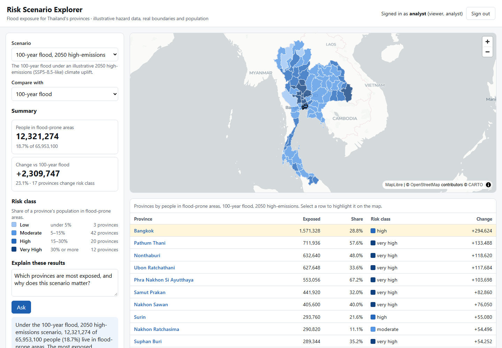
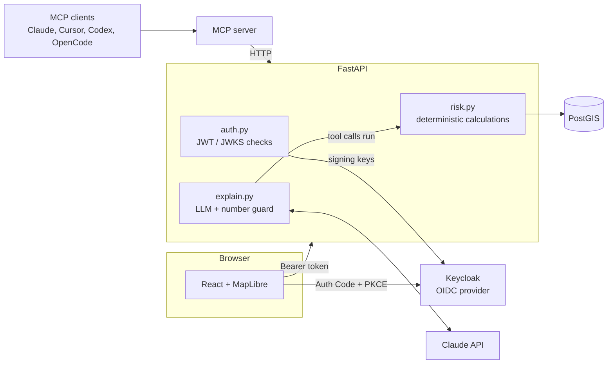

# Risk Scenario Explorer

A small, complete risk platform: pick a flood scenario, see exposure on a map and in a ranked table, compare scenarios,
ask an AI to explain the results, and download them. Built to demonstrate one architectural rule end to end:

> **Calculated results come from one deterministic service. The language model may explain them, never produce them.**

**Live demo:** https://tk87tech.github.io/Risk-scenario-explorer/ (static snapshot: map, comparison, explanations, downloads).
The full stack below adds OIDC sign-in, role-based access, AI explanations and the MCP server.



| | |
|---|---|
| **Frontend** | React 19 + TypeScript + MapLibre GL · accessible table, keyboard-usable, colour never the only cue |
| **Backend** | FastAPI · PostgreSQL 16 + PostGIS · Alembic migrations · OpenAPI docs at `/docs` |
| **AI** | Claude tool calling with a **number guard**: answers containing any number not returned by a tool are rejected |
| **MCP** | MCP server exposing the same results as tools (stdio and Streamable HTTP) |
| **Security** | OIDC sign-in (Authorization Code + PKCE, Keycloak) · API verifies signature, issuer, audience, expiry · role-based access |
| **Quality** | pytest (incl. reference questions with expected answers) · Vitest · Playwright E2E · OIDC smoke test · GitHub Actions |
| **Delivery** | `docker compose up` · non-root containers · health and readiness checks |

## Architecture



- **One source of results.** `api/app/risk.py` holds every calculation. The REST endpoints, the LLM's tools and the MCP
  server (which calls the API over HTTP) all return the same numbers.
- **Bounded explanations.** The model gets numbers only by calling tools. `explain.py` then extracts every number from its
  answer and checks it against the tool outputs; one unsupported number and the answer is replaced with a deterministic
  template (the UI says so). With no API key configured, the template is used directly, so the app works offline.
- **Access control is enforced in the API**, not the UI: anyone can view; signed-in users can ask for explanations;
  only the `analyst` role can download.

## Run it

Requirements: Docker. Optional: an Anthropic or OpenRouter API key for AI explanations (OpenRouter has free models).

```bash
cp .env.example .env            # optional: add ANTHROPIC_API_KEY, or set LLM_PROVIDER=openrouter + OPENROUTER_API_KEY
docker compose up --build
```

| Service | URL |
|---|---|
| Web app | http://localhost:5173 |
| API + OpenAPI docs | http://localhost:8000/docs |
| Keycloak (admin / admin) | http://localhost:8081 |
| MCP (Streamable HTTP) | http://localhost:8001/mcp |

Demo accounts: **viewer / viewer** (can ask questions) and **analyst / analyst** (can also download).

### Use the MCP server from an MCP client

```bash
# Claude Code, over stdio
claude mcp add risk-explorer -e API_BASE_URL=http://localhost:8000 -- python mcp_server/server.py

# Or point any client that supports Streamable HTTP at http://localhost:8001/mcp
```

Tools: `list_scenarios`, `get_scenario_summary`, `get_province_result`, `compare_scenarios`.

## Static demo (GitHub Pages)

`.github/workflows/pages.yml` builds the frontend with `VITE_STATIC_DATA=true`, so it reads a snapshot in
`web/public/data/` instead of calling the API. Regenerate the snapshot after changing data or calculations:

```bash
docker compose up -d db api
cd api && python ../scripts/export_static.py
```

## Tests

```bash
cd api && pip install -r requirements.txt && pytest          # 25 tests, no database or API key needed
cd web && npm ci && npm test && npm run build                 # unit tests, type-check, production build
python scripts/oidc_smoke_test.py                             # real OIDC sign-in against the running stack
cd e2e && npm install && npx playwright install chromium && npx playwright test   # browser E2E
```

The **reference questions** in `api/tests/reference_questions.yaml` pin expected answers (computed by hand from fixture
data) for critical questions, and run on every change. Other tests use fake LLM clients to prove that a grounded answer
passes and an answer with an invented number ("roughly 1.7 million") is rejected.

## Data

| Data | Source | Licence |
|---|---|---|
| Province boundaries (77, simplified) | [geoBoundaries](https://www.geoboundaries.org/) THA ADM1 (OpenStreetMap, Wambacher) | ODbL 1.0 |
| Province population | December 2024 estimates (rounded), as listed on Wikipedia's *Provinces of Thailand* | CC BY-SA 4.0 |
| Flood shares per scenario | **Illustrative**, see `data/scenarios.yaml` | n/a |

**The hazard figures are illustrative and are not a flood risk assessment.** In a real deployment, the `hazard` table
would be filled by a zonal-statistics job over a hazard dataset (for example the JRC Global Flood Hazard Maps) or a
hydrological model. Nothing else in the stack would change.

## Project layout

```
api/            FastAPI app, Alembic migrations, seed script, pytest suite
mcp_server/     MCP server (calls the API)
web/            React + TypeScript + MapLibre frontend, served by nginx in Docker
keycloak/       Demo realm: client with PKCE, audience mapper, viewer/analyst roles
e2e/            Playwright tests
scripts/        OIDC smoke test
data/           Boundaries, population, scenario parameters
```

## What I'd add for production

Managed secrets instead of demo credentials and `start-dev` Keycloak; HTTPS and a reverse proxy; vector tiles for
large datasets; structured logging shipped to a central store with metrics and alerts; database backups with a tested
restore; rate limiting on `/api/explain`; and a governance review loop for AI explanations (sampling answers, tracking
guard rejections).

## Licence

MIT. Built by [Thankgod Ugwuada](https://github.com/TK87tech).
